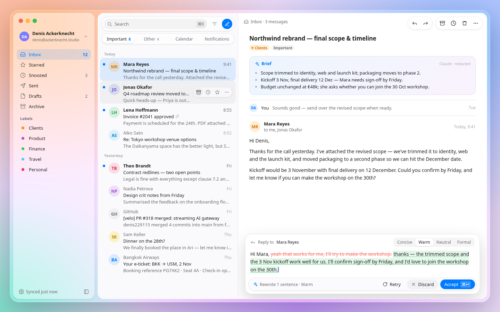
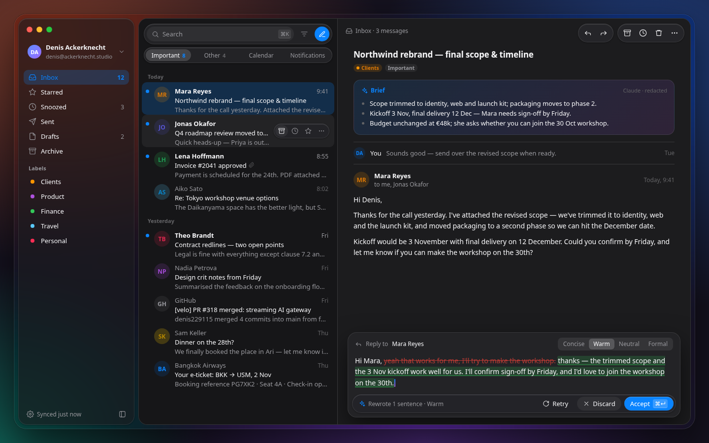

# Velo design system — Liquid Glass

This is the target visual language for Velo. The tokens live in `src/styles/theme.css` and are exposed to Tailwind from `src/styles/globals.css`. The app still renders on the existing semantic tokens (`--surface-*`, `--text-*`, `--status-*`, `--color-accent`). A later pass moves components onto the tokens below. Until then, do not invent a third palette.

Reference mockups:





`docs/velo.html` is the static mockup those images were rendered from. When a number here and a number in that file disagree, the table in this document wins.

## Principles

Liquid Glass is a material for the navigation and control layer. Content stays solid.

- The sidebar, toolbars, tabs, hover actions, menus and the AI prompt bar are glass.
- The list, the reader, the message body and the reply sheet are solid. Text is never placed on a blur that the reader has to see through.
- One window, one accent. The accent is the macOS system accent when the engine exposes it, otherwise `#007AFF` in light and `#0A84FF` in dark.
- Corners are concentric: an inner rounded rectangle uses the outer radius minus the gap, so the curves share a centre.
- Motion is short and decelerates. Nothing bounces.
- Colour, type and elevation have one scale each. Components do not introduce one-off hex values.

## Materials

Glass is a fill, a blur, a saturation boost, a 1px edge and a 1px inset highlight. The highlight is the top edge only (`inset 0 1px 0`).

| Token | Light | Dark | Role |
| --- | --- | --- | --- |
| `--glass-bar-fill` | `rgba(255, 255, 255, 0.62)` | `rgba(40, 40, 44, 0.55)` | Toolbars, search, tabs, action capsules |
| `--glass-pop-fill` | `rgba(250, 250, 252, 0.78)` | `rgba(36, 36, 40, 0.72)` | Menus, hover actions, the AI bar |
| `--glass-side-fill` | `rgba(255, 255, 255, 0.34)` | `rgba(30, 30, 34, 0.42)` | Floating sidebar |
| `--glass-blur` | `24px` on bar and sidebar | same | |
| `--glass-pop-blur` | `32px` | same | Popovers sit above more varied content |
| `--glass-saturate` | `180%` | same | |
| `--glass-edge` | `rgba(0, 0, 0, 0.08)` | `rgba(255, 255, 255, 0.10)` | 1px border |
| `--glass-highlight` | `rgba(255, 255, 255, 0.70)` | `rgba(255, 255, 255, 0.12)` | Inset top highlight |

Bar and sidebar share `blur(24px) saturate(180%)`. Popovers use `blur(32px) saturate(180%)`.

`--glass-bar`, `--glass-pop` and `--glass-side` are the colours to paint. On macOS (`html.platform-mac`) they resolve to the fills above. Off macOS, under `.reduce-transparency`, under `.increase-contrast`, and when the OS asks for reduced transparency or more contrast, they resolve to the solid stand-ins and the blur goes to `0`:

| Solid | Light | Dark |
| --- | --- | --- |
| `--glass-bar-solid` | `#FFFFFF` | `#2C2C2E` |
| `--glass-pop-solid` | `#FAFAFC` | `#242428` |
| `--glass-side-solid` | `#F5F5F7` | `#1C1C1E` |

The highlight is `transparent` in those fallbacks, so a solid control does not pretend to be lit glass. The 1px edge stays.

`.glass-bar` and `.glass-pop` in `globals.css` are the only implementations of this recipe. They are not applied to product surfaces yet. The current sidebar still uses `.glass-sidebar` and `--surface-sidebar`.

## Palette

macOS system colours. These do not replace `--text-primary`, `--separator` or `--status-*` until a surface is restyled. The existing status colours are the ones that meet WCAG AA for small text; the system colours below are for icons, dots, fills and large labels.

| Token | Light | Dark |
| --- | --- | --- |
| `--system-label` | `#1D1D1F` | `#F5F5F7` |
| `--system-label-secondary` | `#6E6E73` | `#98989D` |
| `--system-label-tertiary` | `#AEAEB2` | `#636366` |
| `--system-separator` | `#E5E5EA` | `#38383A` |
| `--system-content` | `#FFFFFF` | `#1C1C1E` |
| `--system-list` | `#FAFAFC` | `#161618` |
| `--system-hover` | `rgba(0, 0, 0, 0.04)` | `rgba(255, 255, 255, 0.06)` |
| `--system-press` | `rgba(0, 0, 0, 0.08)` | `rgba(255, 255, 255, 0.10)` |
| `--system-accent` | `#007AFF` | `#0A84FF` |
| `--system-accent-soft` | `rgba(0, 122, 255, 0.12)` | `rgba(10, 132, 255, 0.22)` |
| `--system-success` | `#34C759` | `#30D158` |
| `--system-warning` | `#FF9500` | `#FF9F0A` |
| `--system-danger` | `#FF3B30` | `#FF453A` |
| `--system-success-soft` | `rgba(52, 199, 89, 0.14)` | `rgba(48, 209, 88, 0.18)` |
| `--system-ai` | `#AF52DE` | `#BF5AF2` |
| `--system-kbd` | `rgba(0, 0, 0, 0.05)` | `rgba(255, 255, 255, 0.08)` |
| `--system-kbd-edge` | `rgba(0, 0, 0, 0.12)` | `rgba(255, 255, 255, 0.16)` |

`--system-accent` uses the CSS system colour `AccentColor` when the engine supports it, including in dark appearance. The hex values are the fallback. `--system-accent-soft` is a 12% wash of the light blue and a 22% wash of the dark blue. When a non-blue system accent is active, mix the same percentage of `--system-accent` rather than keeping the blue wash.

`--system-ai` is only for the assistant: the brief, the streaming caret and the spark. It is not a second theme accent.

Label tertiary is for timestamps, placeholders and empty counts. It is too light for body text. Secondary is for previews, metadata and inactive tabs. Primary label is for names, subjects and message text.

The current accent presets (`--color-accent` and the nine themes) stay as they are. The restyle adopts `--system-accent` as the default and can keep the presets as explicit overrides.

## Type

On macOS the UI font is SF Pro, via `-apple-system`. Everywhere else, and as the fallback, it is Inter Variable, which the app already bundles.

`--font-ui` is:

```text
-apple-system, BlinkMacSystemFont, "SF Pro Text", "SF Pro Display", "Inter Variable", Inter, system-ui, sans-serif
```

`--font-sans` still starts with `"Inter Variable"` and is what the app renders today. The restyle switches `body` to `--font-ui`.

The scale is six sizes. Values are `rem` so the existing font-scale settings still apply. At the default scale, 1rem is 16px.

| Token | Size | Used for | Existing utility |
| --- | --- | --- | --- |
| `--type-11` | 11px | Timestamps, section labels, key chips, footnotes | `text-meta` |
| `--type-12` | 12px | Previews, tabs, secondary meta | `text-preview` |
| `--type-13` | 13px | UI default: nav, rows, buttons | `text-row` |
| `--type-15` | 15px | Reading body | `text-callout` |
| `--type-17` | 17px | Thread title | `text-headline` |
| `--type-22` | 22px | Page title | `text-title` |

Tracking is `-0.003em` on UI text (`--type-tracking`) and `-0.012em` on the 17px title (`--type-tracking-title`). Line height is about 1.3 for titles and 1.45–1.6 for reading text. Numbers in counts and times use tabular figures.

Weights: 400 body, 500 controls and unread subjects, 600 titles, names and the selected nav count. Do not use 700.

The mockup draws message body at 14px. The scale has no 14. Reading text uses 15.

## Radii

Corners are concentric. `inner = outer − inset`.

| Token | Value | Where |
| --- | --- | --- |
| `--radius-window` | 26px | The window |
| `--radius-shell` | 18px | Floating sidebar and content panel. 26 − 8px frame gap |
| `--radius-sidebar` | 16px | Navigation rows' container when it is not the floating shell |
| `--radius-panel` | 12px | Inset cards such as the brief |
| `--radius-menu` | 12px | Menus and popovers |
| `--radius-menu-item` | 7px | Rows inside a 12px menu |
| `--radius-control` | 8px | Buttons and fields |
| `--radius-control-sm` | 6px | Segmented controls, small fields |
| `--radius-chip` | 4px | Key chips. Count pills are fully round |
| `--radius-modal` | 16px | Dialogs |
| `--radius-capsule` | 999px | Search, tabs, toolbars, primary buttons |

The current app frame still uses `--panel-radius` (10px) and `--frame-gap` (8px). Those stay until the frame is restyled. `--radius-shell` is the target for that frame.

A capsule inside a 12px menu does not need a concentric correction; pills are independent.

## Elevation

Shadows are for separation from the surface underneath, not for decoration. Dark appearance uses about twice the alpha so the same offsets still read.

| Token | Light | Dark | Where |
| --- | --- | --- | --- |
| `--elev-0` | none | none | List, reader, solid sheets that sit on the panel |
| `--elev-1` | `0 1px 3px rgba(0, 0, 0, 0.08)` | alpha 0.16 | Glass controls, plus the inset highlight |
| `--elev-2` | `0 8px 24px rgba(0, 0, 0, 0.12)` | alpha 0.24 | Menus, popovers, hover actions |
| `--elev-3` | `0 20px 50px rgba(0, 0, 0, 0.20)` | alpha 0.40 | Reply sheet, dialogs |

Selected segmented tabs use a separate 1px shadow, `0 1px 2px rgba(0, 0, 0, 0.12)`, because they sit inside a capsule rather than above the window.

The current menus still use `--overlay-shadow`. Point them at `--elev-2` when they move to glass.

## Motion

One curve, three durations.

| Token | Value |
| --- | --- |
| `--motion-ease` | `cubic-bezier(0.32, 0.72, 0, 1)` |
| `--motion-fast` | 160ms |
| `--motion-base` | 220ms |
| `--motion-slow` | 280ms |

- 160ms: hover, press, tab selection, chip toggle.
- 220ms: menus, the prompt bar, row actions appearing.
- 280ms: dialogs and the reply sheet.

Press scales a control to 0.97. Do not add a hover lift. The existing `--anim-fast` (150ms), `--anim-normal` (200ms) and `--anim-slow` (300ms) remain for transitions that have not moved over.

Reduced motion, from the OS or the in-app setting, already zeroes animation and transition duration. Streaming does not blink a caret in that mode.

## Layout

The window is a 26px rounded rect. Inside it, an 8px gap holds two floating shells at 18px:

1. Sidebar, 236px wide, glass side material. Traffic lights sit in the top padding on macOS. Account row, nav, labels, then a footer pinned to the bottom.
2. Content panel, solid `--system-content`, hairline `--glass-edge`. It is split into a list and a reader.

The list is 404px, fill `--system-list`, with a hairline separator on its right edge. Its toolbar is not a bar across the top of the column. It is a capsule floating 10px from the top and sides, and the category tabs are a second capsule 48px below it. Rows begin after that stack (about 100px of padding) so content scrolls under the glass.

The reader is the remaining width, fill `--system-content`. The thread itself is a 720px column, centered, with 32px of horizontal padding. Action capsules float at the top right. The reply sheet floats at the bottom, centered, max 680px, inset 14px from the bottom of the reader. It is solid, not glass, and uses `--elev-3`.

### List-only

When the reading pane is hidden, the content panel is the list and nothing else. There is no empty reader column and no divider. The floating search capsule and the category tabs stay. Opening a thread replaces the list with the 720px reader and a way back to the list; it does not split the panel. The app already stores this as `readingPanePosition: "hidden"`. The restyle should keep that behaviour and drop the blank pane, not add a second mode.

Right and bottom pane positions keep the list width the user set. The reader column stays 720px max and centers in whatever width remains.

## Components

### Sidebar

Nav row: 30px tall, 9px radius, 10px horizontal padding, icon at secondary colour. The selected row uses `--system-accent-soft` and `--system-accent` for label, icon and count. Counts are 12px tabular, secondary unless selected, then 600. Section labels are 11px, 600, secondary, with 12px of space above. Label dots are 8px circles in the label colour. The footer is 12px secondary.

### Toolbar capsules

Search is a 30px pill inside the bar capsule: leading icon, placeholder in secondary, trailing key chip. Icon buttons beside it are 30px circles. The compose button is the accent fill with white icon. Tabs are 24px pills. The selected tab is `--system-content` (in dark, a 16% white fill) with a 1px shadow. Counts on the selected tab use the accent; other counts use tertiary.

### List rows

66px tall, 10px radius. Unread state is a 7px accent dot, a 600 name in the label colour, and a 500 subject. Read state drops the dot, and the name is 400 secondary. Time is 12px tabular, tertiary, or secondary when unread. The preview is one line, secondary, truncated. Hover shows a glass-pop capsule of 26×24 icon buttons, right aligned, vertically centered. The selected row uses `--system-accent-soft` and keeps its text colours (it does not invert to white).

Avatars are 32px circles. The initials colour is a darkened label hue; the fill is that hue at about 16% opacity.

### Reader

Title is 17px, 600, tracking `-0.012em`. Chips are 16px tall, fully round, 11px and 600. A label chip uses the label colour at 15% with a 6px dot. A neutral chip uses `--system-hover`.

The brief is a 14px-radius card. Its fill is a quiet gradient from the accent wash to the AI wash, with a 1px edge. The heading is 12px, 600, accent, with the spark icon. Bullets use the label colour; markers use tertiary.

Collapsed messages are a single 24px-avatar row on a separator, name at 500, preview truncated, time tertiary.

The open message has a 32px avatar, name at 600, recipients in 12px secondary, time tertiary. Body is 15px, line height 1.6, label colour.

### Buttons

Primary: accent fill, white label, 13px / 500, capsule, inset top highlight `rgba(255, 255, 255, 0.25)`. A key chip on a primary button is white at 20%. Secondary: `--system-hover` fill, label colour, capsule. Ghost: no fill, secondary label, hover uses `--system-hover`. Danger: `--system-danger` fill, white label. 28px tall in the AI bar. Disabled is 50% opacity.

The shared `Button` already uses `--radius-control`. Its colours still follow the current accent and danger tokens.

### Fields

Height follows the button sizes. Radius is `--radius-control-sm` (6px) for compact fields and `--radius-control` (8px) otherwise. Fill is the list or hover colour, border is the separator, focus uses the accent. `TextField` uses the 6px radius.

### Menus

12px radius, `--glass-pop` (solid overlay until the restyle), `--elev-2`, 4px of vertical padding. Items are 7px radius and inset 4px from the menu edge. Destructive items use danger. Shortcuts sit on the trailing edge in tertiary, rendered as key chips. `ContextMenu` uses the menu and item radii on today's solid overlay.

### Key chips

18px tall, min width 18px, 4px radius, 11px / 500, secondary colour. Fill `--system-kbd`, bottom border `--system-kbd-edge`. `Kbd` uses these tokens.

### Dialogs

16px radius, solid `--system-content` (today `--surface-overlay`), `--elev-3`, a scrim of black at 20%. The current `Modal` uses the 16px radius and the existing overlay shadow.

### Reply sheet

Solid content colour (dark mockup uses `#232326`, one step above content). 18px radius, `--elev-3`, max 680px. The header is 12px secondary with the recipient name at 500. The tone control is a segmented capsule: hover fill track, 6px radius segments, the selected segment on content (dark: 18% white) with a 1px shadow.

## AI editor

The assistant edits in place. It does not open a second document.

### Prompt bar (⌘J)

⌘J opens a `--glass-pop` capsule anchored to the composer, the same bar the mockup shows under a rewrite. It holds a spark icon, a text field, and the tone control when a tone applies. Enter or ⌘J submits. Escape closes the bar and leaves the draft untouched. The placeholder is an instruction, not a chat transcript.

### Selection menu

Selecting text in the composer shows a small `--glass-pop` menu above the selection: Rewrite, Shorten, and the tones Concise, Warm, Neutral, Formal. Choosing one starts a rewrite of that selection only. Clicking away or pressing Escape dismisses the menu.

### Inline diff

The previous words stay in the sentence. Deletions use `--system-danger`, strikethrough, at 70% opacity. Insertions use `--system-success-soft`, no strikethrough, with a 1.5px inset underline in the success colour. The bar reports what happened, for example "Rewrote 1 sentence · Warm".

- Accept (⌘↵) commits the insertion, drops the deletion, and closes the bar.
- Discard restores the previous text and closes the bar.
- Retry runs the same instruction again.

Accept and Discard are available for the whole change. There is no per-word accept.

### Streaming

New text appears at the caret as it arrives. The caret is a 2px rounded bar, 16px tall, filled with a gradient from `--system-accent` to `--system-ai`. The bar's label switches from the instruction to the result line when the stream finishes. Discard during a stream aborts it and restores the previous text. Accept enables when the stream finishes. Reduced motion shows the text without a blinking or glowing caret.

The brief at the top of a thread is a separate surface: three bullets, accent heading, a source line in tertiary ("Claude · redacted"). It is not an editor.

## Accessibility

Three OS preferences, each also represented by a class on `<html>` so the app can follow them after first paint:

| Preference | Class | Effect |
| --- | --- | --- |
| `prefers-reduced-motion: reduce`, and the in-app Reduce motion setting | `.reduce-motion` | Animations and transitions drop to 0. Already shipped. |
| `prefers-reduced-transparency: reduce` | `.reduce-transparency` | Glass tokens become the solid stand-ins, blur is 0, the highlight is removed. The current sidebar token becomes `#ECECEC` / `#202020`, including over native vibrancy. |
| `prefers-contrast: more` | `.increase-contrast` | Glass becomes solid. Labels move to black / white, separators and the glass edge darken, and the edge alpha rises to 0.55. |

`platform-mac` is set from the user agent before first paint and again from `useAppearance`. Without it, glass tokens stay solid, so Windows and Linux do not pick up a backdrop blur. An inline script in `index.html` sets the class before the bundle runs; `useAppearance` keeps reduced transparency and increased contrast in sync when the OS setting changes.

Focus remains the existing 2px `--state-focus` ring on `:focus-visible`. It is unlayered, so utilities cannot remove it. Target contrast is 3:1 against the surface.

Do not rely on colour alone for unread state: the dot is paired with a heavier name and subject. Destructive actions use the danger colour and a verb. Key chips stay text, not only symbols, for chords (`Cmd`, `Option`).

## What is wired today

Shipped with this foundation:

- The tokens in `theme.css`, in light and dark.
- Tailwind aliases: `bg-system-*`, `text-system-*`, `bg-glass-*`, `shadow-e0`–`shadow-e3`, `ease-glass`, `rounded-window`, `rounded-shell`, `rounded-panel`, `rounded-menu`, `rounded-control`, `font-ui`, `text-callout`, `text-headline`. Durations are the `--motion-*` variables; `duration-160`, `duration-220` and `duration-280` match them.
- `.glass-bar` and `.glass-pop`, unused by product components.
- Solid fallbacks for non-macOS, reduced transparency and increased contrast.
- Radius updates on `Button`, `TextField`, `Modal` and `ContextMenu`. `Kbd` uses the key-chip colours.

Not done, on purpose:

- Restyling the sidebar, list, reader, composer or settings onto these tokens.
- Switching `body` to `--font-ui`.
- Replacing `--color-accent` or the AA-safe `--status-*` colours.
- Building the ⌘J bar, selection menu, inline diff or streaming caret.

## File map

| File | Holds |
| --- | --- |
| `src/styles/theme.css` | Token values, platform and accessibility overrides |
| `src/styles/globals.css` | Tailwind aliases, `.glass-bar`, `.glass-pop`, `.glass-sidebar` |
| `src/hooks/useAppearance.ts` | `platform-mac`, `reduce-transparency`, `increase-contrast`, plus theme and reduced motion |
| `docs/velo.html` | Static mockup |
| `docs/velo-light.png`, `docs/velo-dark.png` | Renders of that mockup |
